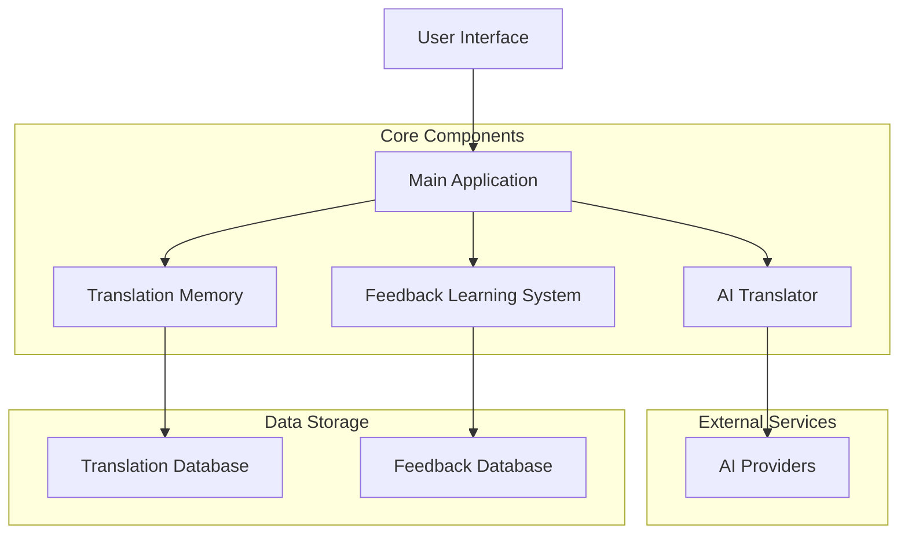
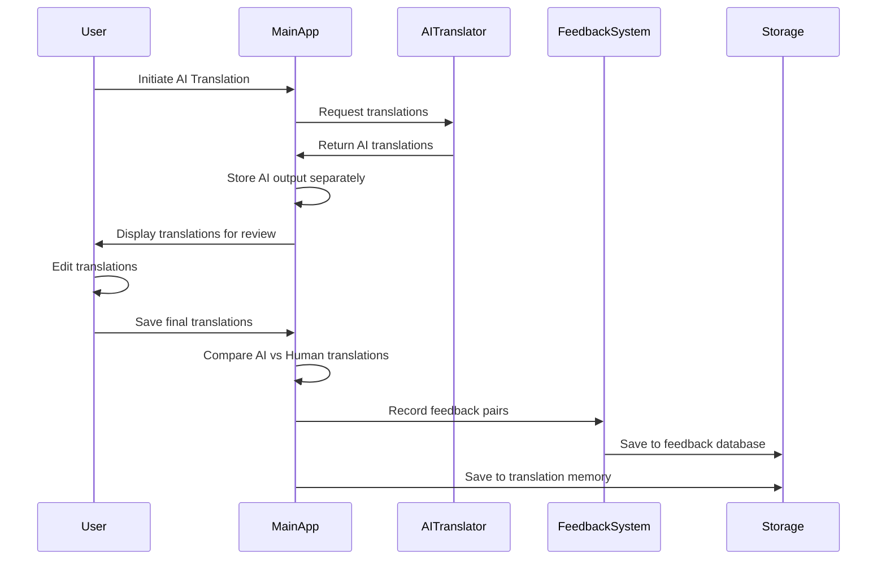

# Ever Learning Translation System - Architecture Plan

## Overview
This plan describes how to implement an "ever learning" feature for MUTT that captures the differences between AI-generated translations and human-edited versions to improve future translations.

## System Architecture



## Data Flow



## Implementation Plan

### 1. Create Feedback Learning System

Create a new `feedback_learning.py` file with the following class:

```python
class FeedbackLearningSystem:
    def __init__(self, db_path: str = "feedback_data.json"):
        self.db_path = db_path
        self.feedback_data = self._load_feedback()
    
    def _load_feedback(self):
        # Load existing feedback data
        pass
    
    def _save_feedback(self):
        # Save feedback data to file
        pass
    
    def add_feedback_entry(self, source, ai_translation, human_translation, 
                          source_lang, target_lang, model_info):
        # Add a new feedback entry
        pass
    
    def get_feedback_patterns(self):
        # Analyze feedback data to identify patterns
        pass
```

### 2. Data Structure for Feedback Entries

Each feedback entry will have the following structure:

```json
{
  "source": "Original text to translate",
  "ai_translation": "AI-generated translation",
  "human_translation": "Human-edited translation",
  "source_lang": "en",
  "target_lang": "es",
  "timestamp": "2025-08-18T22:21:00Z",
  "model_used": "gpt-4",
  "provider": "OpenAI GPT",
  "context": "Optional context used for translation"
}
```

### 3. Modifications to Main Application

#### In `main.py`:

1. Import the new FeedbackLearningSystem:
   ```python
   from feedback_learning import FeedbackLearningSystem
   ```

2. Initialize in MainFrame constructor:
   ```python
   self.feedback_learning = FeedbackLearningSystem()
   ```

3. Add a new attribute to store AI-generated translations:
   ```python
   self.ai_generated_translations = {}  # Store by entry ID
   ```

4. Modify `_run_translation` method to capture AI output:
   ```python
   def _run_translation(self, parent_frame, active_provider, settings, context):
       # Existing code for setting up translator
       def p_cb(p, t): 
           wx.PostEvent(parent_frame, UpdateEvent(value=p, total=t))
       
       try:
           translator = AITranslator(
               active_provider, settings.get("api_key"), settings.get("api_model"),
               batch_size=self.config.get("batch_size", 50),
               temperature=self.config.get("temperature", 0.1),
               max_tokens=self.config.get("max_tokens", 4000),
               max_batch_tokens=self.config.get("max_batch_tokens", 16000)
           )

           # Gather surrounding context if enabled
           surrounding_context = []
           if self.config.get("enable_surrounding_context", False):
               current_batch_start_index = -1
               if self.po_entries and self.all_po_entries:
                   # Find the index of the first entry in the current batch within all_po_entries
                   try:
                       first_msgid_in_batch = self.po_entries[0]['msgid']
                       for idx, entry in enumerate(self.all_po_entries):
                           if entry.get('msgid') == first_msgid_in_batch:
                               current_batch_start_index = idx
                               break
                   except IndexError:
                       pass # Batch might be empty

               if current_batch_start_index != -1:
                   prev_size = self.config.get("context_previous_size", 2)
                   next_size = self.config.get("context_next_size", 2)

                   start_idx = max(0, current_batch_start_index - prev_size)
                   end_idx = min(len(self.all_po_entries), current_batch_start_index + len(self.po_entries) + next_size)
                   
                   # Ensure we don't include the current batch in the surrounding context itself
                   surrounding_context = self.all_po_entries[start_idx:current_batch_start_index] + \
                                         self.all_po_entries[current_batch_start_index + len(self.po_entries):end_idx]

           # Perform translation
           trans_data, usage = translator.translate_entries(
               self.po_entries,
               self.source_language,
               self.target_language,
               context,
               p_cb,
               surrounding_context=surrounding_context
           )
           
           # NEW: Store AI-generated translations
           for entry in trans_data:
               entry_id = entry.get('msgid', '')  # Use msgid as identifier
               self.ai_generated_translations[entry_id] = entry.get('msgstr', '')
           
           wx.PostEvent(parent_frame, ResultEvent(source="translation", result=trans_data, usage=usage, error=None))
       except Exception as e:
           wx.PostEvent(parent_frame, ResultEvent(source="translation", error=e))
   ```

5. Update `_update_translation_memory` method to save feedback:
   ```python
   def _update_translation_memory(self, saved_entries):
       # Use stored instance variables for source and target languages
       src_lang = self.source_language
       tgt_lang = self.target_language
       for entry in saved_entries:
           source = entry.get("msgid", "")
           target = entry.get("msgstr", "")
           if source and target:
               self.translation_memory.add_entry(source, target, src_lang, tgt_lang)
       
       # NEW: Save feedback data
       self._save_feedback_data(saved_entries)
   
   def _save_feedback_data(self, saved_entries):
       # Compare AI translations with final translations and save feedback
       for entry in saved_entries:
           msgid = entry.get('msgid', '')
           ai_translation = self.ai_generated_translations.get(msgid, '')
           human_translation = entry.get('msgstr', '')
           
           # Only save feedback if there's a difference
           if ai_translation and human_translation and ai_translation != human_translation:
               self.feedback_learning.add_feedback_entry(
                   source=msgid,
                   ai_translation=ai_translation,
                   human_translation=human_translation,
                   source_lang=self.source_language,
                   target_lang=self.target_language,
                   model_info={
                       'model': self.config.get("providers", {}).get(self.config.get("last_provider"), {}).get("api_model", ""),
                       'provider': self.config.get("last_provider", "")
                   }
               )
   ```

### 4. Future Enhancements

Once we've collected sufficient feedback data, we can implement:

1. **Pattern Analysis**: Analyze common modification patterns to improve prompts
2. **Post-processing**: Apply learned modifications automatically to new AI output
3. **Quality Scoring**: Predict translation quality based on similarity to high-quality examples
4. **Model Recommendations**: Suggest the best model for specific content types based on past performance

## Benefits

1. **Continuous Improvement**: The system gets better over time as more feedback is collected
2. **Personalized Experience**: Adapts to individual translator preferences
3. **Reduced Editing Time**: AI output becomes more aligned with human expectations
4. **Data-Driven Insights**: Provides valuable information about translation challenges and solutions

This implementation maintains the existing architecture while adding the feedback learning capability as a separate, cleanly integrated component.