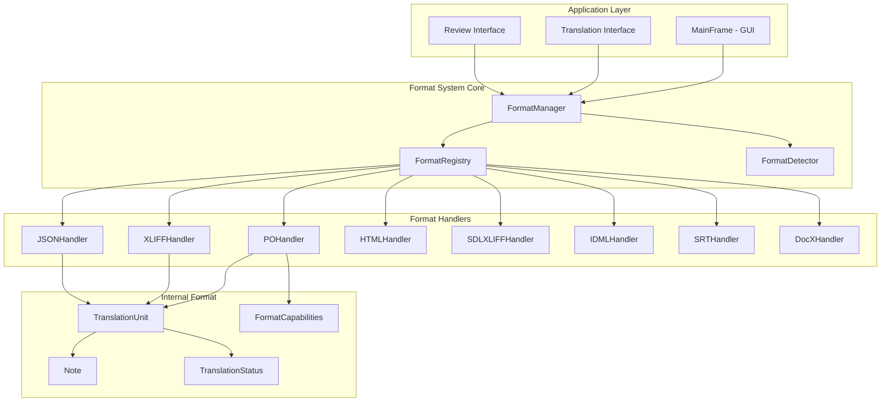
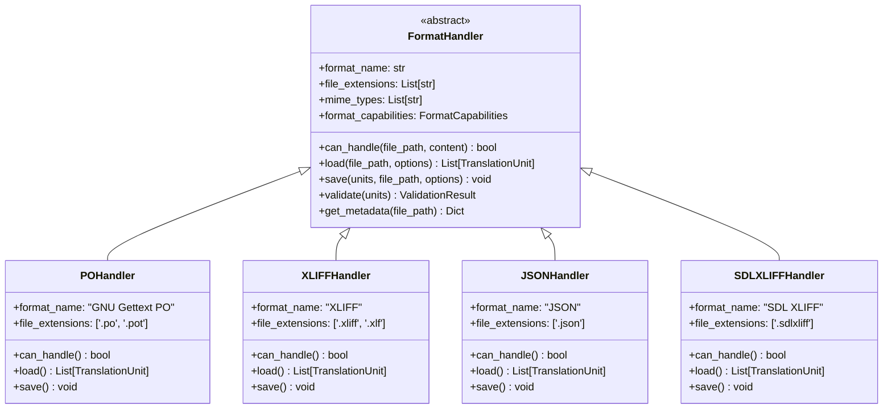
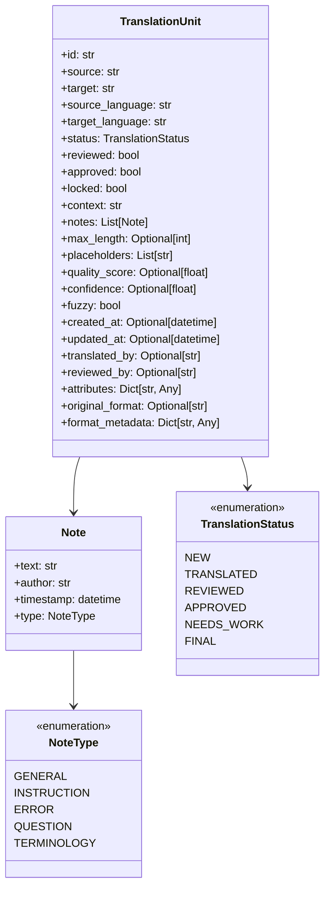
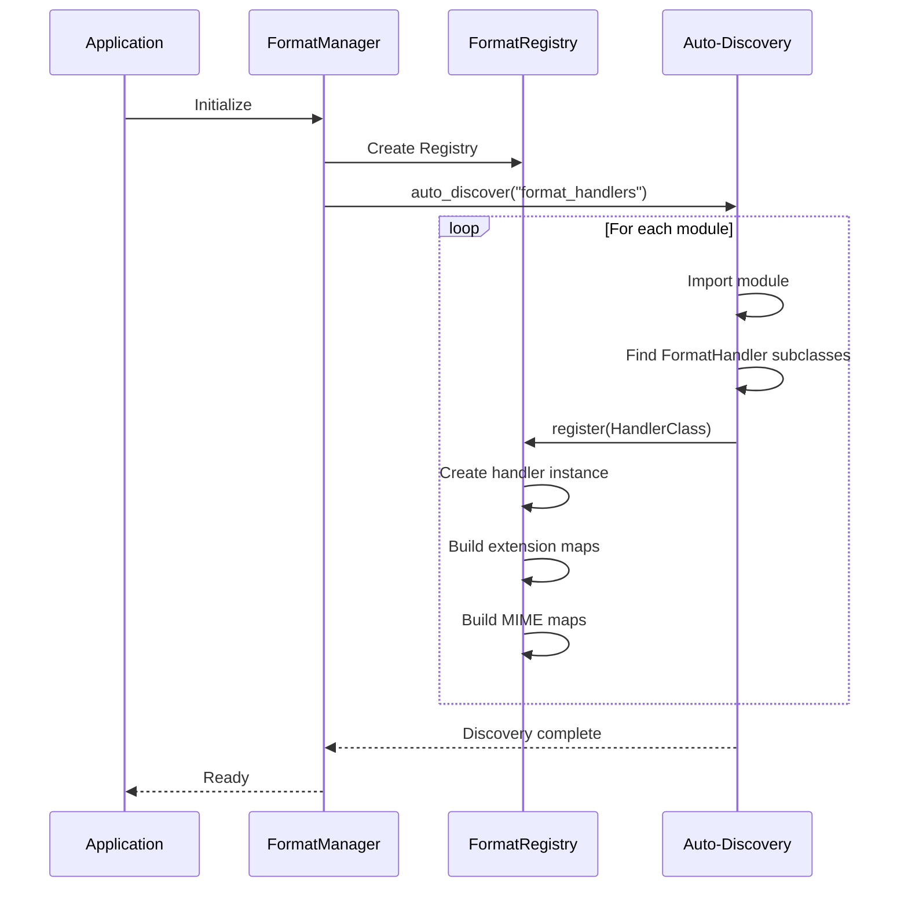
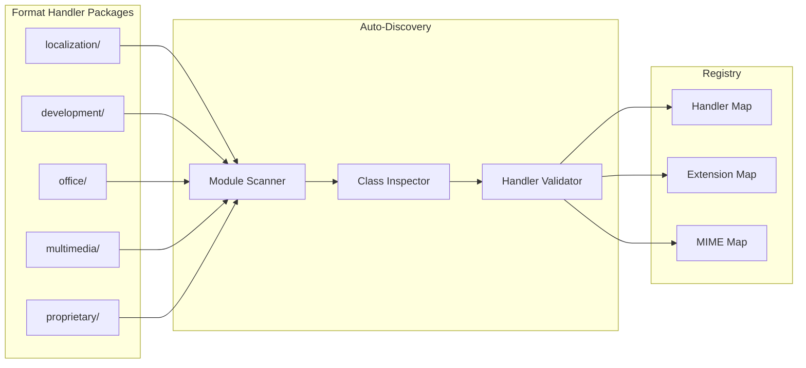
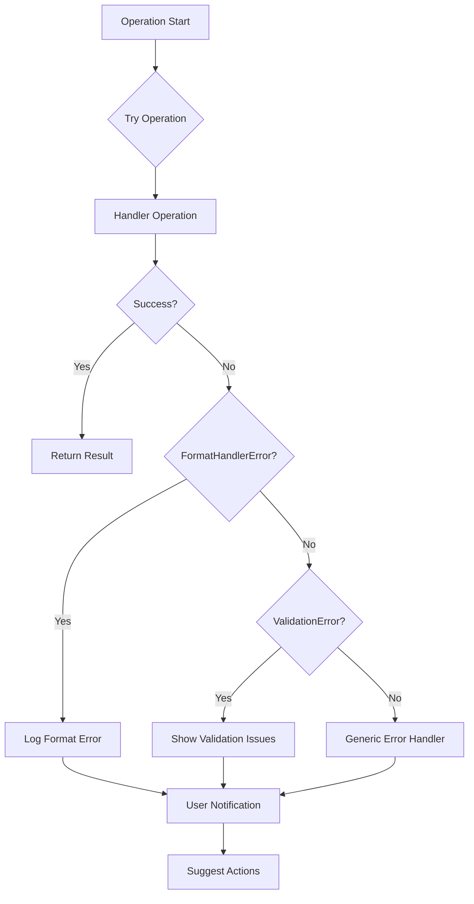

# MUTT Format Handler Architecture Diagrams

## System Overview



## Class Hierarchy



## TranslationUnit Data Model



## Format Detection Flow

```mermaid
flowchart TD
    A[File Input] --> B[Read File Sample]
    B --> C{Extension Match?}
    C -->|Yes| D[Get Extension Handlers]
    C -->|No| E[MIME Type Detection]
    
    D --> F[Test Handler.can_handle()]
    E --> G[Get MIME Handlers]
    G --> H[Test Handler.can_handle()]
    
    F --> I{Handler Found?}
    H --> I
    I -->|Yes| J[Return Handler + Confidence]
    I -->|No| K[Content Analysis Fallback]
    
    K --> L[Test All Handlers]
    L --> M{Any Match?}
    M -->|Yes| N[Return Best Match]
    M -->|No| O[Return None]
```

## Registry Loading Process



## File Processing Workflow

```mermaid
flowchart TD
    A[User Opens File] --> B[FormatManager.load_file()]
    B --> C{Handler Specified?}
    C -->|Yes| D[Get Specific Handler]
    C -->|No| E[FormatDetector.detect_format()]
    
    D --> F[Handler.can_handle()]
    E --> F
    F --> G{Can Handle?}
    G -->|No| H[Raise Error]
    G -->|Yes| I[Handler.load()]
    
    I --> J[Create TranslationUnits]
    J --> K[Enrich with Metadata]
    K --> L[Return Units + Handler]
    
    L --> M[Convert to Legacy Format]
    M --> N[Display in UI]
```

## Save Process Flow

```mermaid
flowchart TD
    A[User Saves File] --> B[Update TranslationUnits]
    B --> C[FormatManager.save_file()]
    C --> D{Handler Specified?}
    D -->|Yes| E[Get Specific Handler]
    D -->|No| F[Determine from Original Format]
    
    E --> G[Handler.validate()]
    F --> G
    G --> H{Valid?}
    H -->|No| I[Raise ValidationError]
    H -->|Yes| J[Handler.save()]
    
    J --> K[Preserve Format Structure]
    K --> L[Write to File]
    L --> M[Success]
```

## Handler Registration Architecture



## Format Capabilities Matrix

```mermaid
graph TD
    subgraph "Format Capabilities"
        A[supports_comments]
        B[supports_context]
        C[supports_plural_forms]
        D[supports_fuzzy_matching]
        E[supports_translation_status]
        F[supports_review_workflow]
        G[supports_character_limits]
        H[supports_placeholders]
        I[supports_file_metadata]
        J[supports_inline_elements]
        K[supports_attributes]
        L[binary_format]
        M[preserves_structure]
    end
    
    subgraph "PO Format"
        A --> N[✓]
        B --> O[✓]
        C --> P[✓]
        D --> Q[✓]
        E --> R[✓]
        F --> S[✗]
        G --> T[✗]
        H --> U[✗]
        I --> V[✓]
        J --> W[✗]
        K --> X[✓]
        L --> Y[✗]
        M --> Z[✓]
    end
```



## Error Handling Flow



## Extension and MIME Type Mapping

```mermaid
graph LR
    subgraph "File Extensions"
        A[.po]
        B[.xliff]
        C[.json]
        D[.sdlxliff]
        E[.idml]
        F[.srt]
    end
    
    subgraph "MIME Types"
        G[text/x-gettext-translation]
        H[application/x-xliff+xml]
        I[application/json]
        J[application/x-sdlxliff+xml]
        K[application/x-adobe-idml]
        L[text/srt]
    end
    
    subgraph "Handlers"
        M[POHandler]
        N[XLIFFHandler]
        O[JSONHandler]
        P[SDLXLIFFHandler]
        Q[IDMLHandler]
        R[SRTHandler]
    end
    
    A --> M
    G --> M
    B --> N
    H --> N
    C --> O
    I --> O
    D --> P
    J --> P
    E --> Q
    K --> Q
    F --> R
    L --> R